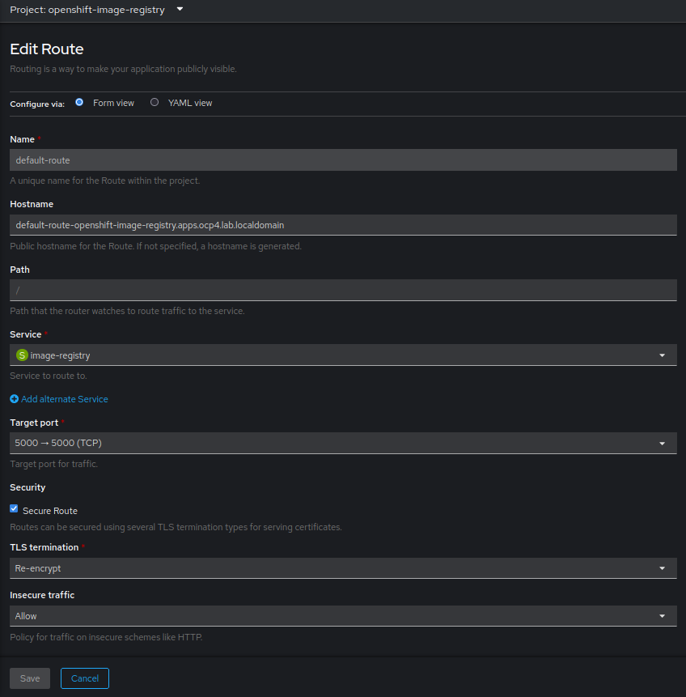

Ref: https://docs.redhat.com/en/documentation/openshift_container_platform/4.20/html/registry/setting-up-and-configuring-the-registry#configuring-registry-storage-baremetal  
  
[Source: `Sources/odf-image-registry-pvc.yaml`](Sources/odf-image-registry-pvc.yaml)
<!-- embed-code: ./Sources/odf-image-registry-pvc.yaml -->
```yaml
apiVersion: v1
kind: PersistentVolumeClaim
metadata:
  name: odf-image-registry-pvc
  namespace: openshift-image-registry
spec:
  accessModes:
    - ReadWriteMany
  resources:
    requests:
      storage: 100Gi
  storageClassName: ocs-storagecluster-cephfs
```
```bash
oc patch configs.imageregistry.operator.openshift.io/cluster --type=merge --patch '{"spec":{"defaultRoute":true}}' 
oc patch configs.imageregistry.operator.openshift.io cluster --type merge --patch '{"spec":{"managementState":"Managed","storage":{"pvc":{"claim":"odf-image-registry-pvc"}}}}'
```

```bash
oc get clusteroperator image-registry
```
Edit default route to disable TLS and map port 5000 (Allow insecure):  
   
  
```bash
oc get image.config.openshift.io cluster \
  -o jsonpath='{.status.internalRegistryHostname}{"\n"}'

oc get configs.imageregistry.operator.openshift.io cluster -o yaml

oc get pods,svc -n openshift-image-registry

oc get co image-registry

image-registry.openshift-image-registry.svc:5000
apiVersion: imageregistry.operator.openshift.io/v1
kind: Config
metadata:
  creationTimestamp: "2026-09-05T02:50:19Z"
  finalizers:
  - imageregistry.operator.openshift.io/finalizer
  generation: 4
  name: cluster
  resourceVersion: "32098795"
  uid: d350cb21-3acc-4cd0-9a61-f8ef7b13c2e4
spec:
  defaultRoute: true
  httpSecret: 5a130911fb3b3ec9abdecafa61bb0515f13b4ab7f3d0e85c9acb5248ad2ee34a832acd4b5f82f99f776d72c801e37c9bf71725c58147970a7da9ee3f5d29d97f
  logLevel: Normal
  managementState: Managed
  observedConfig:
    servingInfo:
      cipherSuites:
      - TLS_AES_128_GCM_SHA256
      - TLS_AES_256_GCM_SHA384
      - TLS_CHACHA20_POLY1305_SHA256
      - TLS_ECDHE_ECDSA_WITH_AES_128_GCM_SHA256
      - TLS_ECDHE_RSA_WITH_AES_128_GCM_SHA256
      - TLS_ECDHE_ECDSA_WITH_AES_256_GCM_SHA384
      - TLS_ECDHE_RSA_WITH_AES_256_GCM_SHA384
      - TLS_ECDHE_ECDSA_WITH_CHACHA20_POLY1305_SHA256
      - TLS_ECDHE_RSA_WITH_CHACHA20_POLY1305_SHA256
      minTLSVersion: VersionTLS12
  operatorLogLevel: Normal
  proxy: {}
  replicas: 1
  requests:
    read:
      maxWaitInQueue: 0s
    write:
      maxWaitInQueue: 0s
  rolloutStrategy: RollingUpdate
  storage:
    managementState: Unmanaged
    pvc:
      claim: odf-image-registry-pvc
  unsupportedConfigOverrides: null
status:
  conditions:
  - lastTransitionTime: "2026-10-07T17:41:02Z"
    message: The registry is ready
    reason: Ready
    status: "False"
    type: Progressing
  - lastTransitionTime: "2026-10-12T13:00:28Z"
    message: The registry is ready
    reason: Ready
    status: "True"
    type: Available
  - lastTransitionTime: "2026-10-12T13:00:28Z"
    status: "False"
    type: Degraded
  - lastTransitionTime: "2026-09-08T14:54:08Z"
    status: "False"
    type: Removed
  - lastTransitionTime: "2026-09-05T02:51:04Z"
    status: "False"
    type: ConfigObservationDegraded
  - lastTransitionTime: "2026-09-05T02:51:04Z"
    reason: AsExpected
    status: "False"
    type: ImageRegistryCertificatesControllerDegraded
  - lastTransitionTime: "2026-09-05T02:51:04Z"
    reason: AsExpected
    status: "False"
    type: AzureStackCloudControllerDegraded
  - lastTransitionTime: "2026-09-05T02:51:09Z"
    message: The daemon set node-ca has available replicas
    reason: AsExpected
    status: "True"
    type: NodeCADaemonAvailable
  - lastTransitionTime: "2026-10-07T16:41:00Z"
    message: The daemon set node-ca is deployed
    reason: AsExpected
    status: "False"
    type: NodeCADaemonProgressing
  - lastTransitionTime: "2026-09-05T02:51:05Z"
    reason: AsExpected
    status: "False"
    type: NodeCADaemonControllerDegraded
  - lastTransitionTime: "2026-09-05T02:51:08Z"
    reason: AsExpected
    status: "False"
    type: ImageConfigControllerDegraded
  - lastTransitionTime: "2026-09-08T14:54:08Z"
    reason: PVC Exists
    status: "True"
    type: StorageExists
  generations:
  - group: apps
    hash: ""
    lastGeneration: 5
    name: node-ca
    namespace: openshift-image-registry
    resource: daemonsets
  - group: apps
    hash: ""
    lastGeneration: 6
    name: image-registry
    namespace: openshift-image-registry
    resource: deployments
  observedGeneration: 4
  readyReplicas: 1
  storage:
    managementState: Unmanaged
    pvc:
      claim: odf-image-registry-pvc
  storageManaged: false
NAME                                                  READY   STATUS      RESTARTS   AGE
pod/cluster-image-registry-operator-85ccbcb46-77976   1/1     Running     3          4d
pod/image-pruner-29858400-d85zf                       0/1     Completed   0          4d1h
pod/image-pruner-29859840-z7hp7                       0/1     Completed   0          3d1h
pod/image-pruner-29864160-vh8dc                       0/1     Completed   0          66m
pod/image-registry-6d6d68f9c8-gfxfn                   1/1     Running     2          4d
pod/node-ca-ltwst                                     1/1     Running     4          5d8h
pod/node-ca-s466b                                     1/1     Running     3          5d8h
pod/node-ca-s5wf6                                     1/1     Running     4          5d8h

NAME                              TYPE        CLUSTER-IP     EXTERNAL-IP   PORT(S)     AGE
service/image-registry            ClusterIP   172.30.6.108   <none>        5000/TCP    34d
service/image-registry-operator   ClusterIP   None           <none>        60000/TCP   37d
NAME             VERSION   AVAILABLE   PROGRESSING   DEGRADED   SINCE   MESSAGE
image-registry   4.22.16   True        False         False      12h
[dave@rhel9dummy2 ~]$ oc whoami -t
sha256~dznLnDdoTZRylAeoy3gVeKSbRKa2avy7j2siQ66PFwc
[dave@rhel9dummy2 ~]$ oc exec -n openshift-image-registry deployment/image-registry \
  -- df -h /registry
Filesystem                                                                                                                                                                                                                               Size  Used Avail Use% Mounted on
csi-cephfs-node-ceph-user-g1-b09e25da-d8ea-4ab1-8f2a-f384ad346294@576f91c2-f2f2-402c-b8dd-94ca125c0fb1.ocs-storagecluster-cephfilesystem=/volumes/csi/csi-vol-dc23724f-4c52-4cc4-b6a3-2c51df1e38bd/b7fa0236-7ad0-4ea4-a1e0-c01734205c39  100G  168M  100G   1% /registry
```