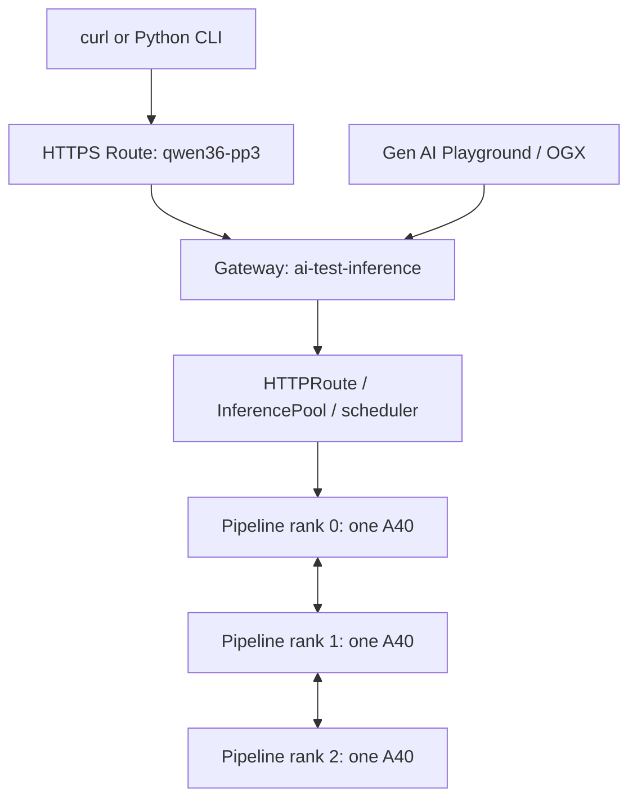

# Three A40 GPUs Serving One Qwen Model on OpenShift AI 3.5

**Recreation runbook • updated October 19, 2026 from the refreshed live capture**

This document records the configuration that worked in this environment: one Qwen model split across three servers, with one NVIDIA A40 per server, llm-d routing, RoCE communication, an external HTTPS Route, and the OpenShift AI Gen AI Playground.

The manifests below are a clean reconstruction from the uploaded configuration and the successful changes in this conversation. Generated status, UIDs, resource versions, and credentials are excluded. They have not been reapplied to the live cluster as part of writing this document.

> **Scope:** This starts with a functioning OpenShift AI cluster and the GPU, network, storage, Gateway API, and llm-d operators already installed. Section 13 now includes the captured GPU/Network Operator policies, host networking, storage settings, and AI configuration. Section 10 includes the complete Playground configuration and database manifests. Switch configuration, SCC/RBAC assignments, model image contents, and database backups remain external prerequisites.

## Contents

1. [Working architecture and settings](#1-working-architecture-and-settings)
2. [Prerequisites and installation checks](#2-prerequisites-and-installation-checks)
3. [Namespace and RoCE network](#3-namespace-and-roce-network)
4. [Internal registry and ModelCar](#4-internal-registry-and-modelcar)
5. [Persistent registry pull credentials](#5-persistent-registry-pull-credentials)
6. [Custom pipeline-parallel runtime template](#6-custom-pipeline-parallel-runtime-template)
7. [Namespace-local Gateway](#7-namespace-local-gateway)
8. [Three-node model service](#8-three-node-model-service)
9. [External HTTPS Route](#9-external-https-route)
10. [Gen AI Playground and OGX](#10-gen-ai-playground-and-ogx)
11. [Validation and performance](#11-validation-and-performance)
12. [Operations and troubleshooting](#12-operations-and-troubleshooting)
13. [Capture the live configuration](#13-capture-the-live-configuration)
14. [Python CLI](#14-python-cli)
15. [References](#15-references)

## 1. Working architecture and settings

| Setting | Working value |
|---|---|
| Platform | OpenShift Container Platform 4.22; operator output showed 4.22.16 |
| AI platform | Red Hat OpenShift AI 3.5 |
| Runtime | vLLM `0.24.0+rhaiv.13` |
| Namespace | `ai-test` |
| Model | `RedHatAI/Qwen3.6-35B-A3B-FP8` |
| Serving resource | `qwen36-35b-a3b-fp8-pp3` |
| Display name | Qwen3.6-35B-A3B-FP8 - Three A40s |
| Servers | `ocp113.localdomain`, `ocp114.localdomain`, `ocp115.localdomain` |
| GPUs | One NVIDIA A40 per server; three GPUs total |
| Parallelism | Tensor `1`; pipeline `3`; one model replica group |
| Layer split seen in logs | `[13,14,13]` |
| Per serving pod | 6 CPU; 32Gi host RAM; one GPU; one shared RDMA resource allocation |
| Network attachment | `ai-test/rdma-bond`; macvlan on `bond1`; MTU 9000 |
| Secondary IPv4 network | `172.16.101.0/24`, allocated by Whereabouts |
| HCA seen in logs | `mlx5_bond_0`, port 1, RoCE |
| Pull secret | `qwen36-35b-a3b-fp8` |
| Gateway | `ai-test/ai-test-inference`, class `openshift-default` |
| External Route | `ai-test/qwen36-pp3` |
| Model API authentication | Disabled in the working lab configuration |
| Playground backend | OGXServer `ai-test/lsd-genai-playground` |

The three GPUs hold different pipeline stages of the same model. They are not three independent full-model replicas. Increasing the replica count would create additional distributed groups and require more GPUs. Pipeline parallelism increases available model capacity and can improve throughput under concurrent load; it does not imply a threefold improvement for a single chat.

The request path is:



Stage placement is scheduled dynamically. The observed leader ran on `ocp114`, rank 1 on `ocp115`, and rank 2 on `ocp113`; that ordering is not required. Each node advertises only one full GPU, so one-GPU requests distribute the three serving pods across the three available nodes.

## 2. Prerequisites and installation checks

Required infrastructure:

- OpenShift AI with KServe LLMInferenceService and llm-d dependencies configured.
- NVIDIA GPU Operator with full-GPU allocation enabled; three allocatable A40 GPUs.
- NVIDIA Network Operator / RDMA shared device plugin exposing `rdma/rdma_shared_device_dx_bond`.
- Multus, macvlan, and Whereabouts, with working `bond1` connectivity on all three servers.
- Leader Worker Set Operator; the observed version was `1.0.1`.
- A working GatewayClass named `openshift-default` with inference routing support.
- Working internal image registry storage and the ModelCar image described below.
- The versioned KServe base configurations, including router/scheduler templates used by the custom runtime.
- For the Playground: Gen AI Studio and OGX enabled, with a working OGXServer and its persistent stores.
- For the commands: `oc`, `jq`, Bash, and cluster-admin access for cluster-scoped setup.

```bash
oc get nodes -L nvidia.com/gpu.product

oc get nodes -o json | jq -r '
  .items[] |
  [.metadata.name,
   .status.allocatable["nvidia.com/gpu"],
   .status.allocatable["rdma/rdma_shared_device_dx_bond"]] | @tsv
'

oc get crd llminferenceservices.serving.kserve.io
oc get crd leaderworkersets.leaderworkerset.x-k8s.io
oc get gatewayclass
oc get llminferenceserviceconfigs -n redhat-ods-applications
```

All three nodes reported `nvidia.com/gpu: 1` and shared RDMA capacity `1k` (1,000 allocation units, not 1,000 physical NICs). An RDMA allocation of `1` exposes shared device access; it is not a bandwidth reservation.

The custom template includes `IPC_LOCK`, `SYS_RAWIO`, and `NET_RAW`. The cluster admission/SCC configuration must permit the template on a fresh installation. Preserve the working service-account/SCC assignments; do not solve admission failures by granting broad privileged access to the namespace.

## 3. Namespace and RoCE network

```bash
oc create namespace ai-test --dry-run=client -o yaml | oc apply -f -
```

Save the following as `01-rdma-bond.yaml` if the NAD is not already managed by the Network Operator:

```yaml
apiVersion: k8s.cni.cncf.io/v1
kind: NetworkAttachmentDefinition
metadata:
  name: rdma-bond
  namespace: ai-test
spec:
  config: |-
    {
      "cniVersion": "0.3.1",
      "name": "rdma-bond",
      "type": "macvlan",
      "master": "bond1",
      "mode": "bridge",
      "mtu": 9000,
      "ipam": {
        "type": "whereabouts",
        "range": "172.16.101.0/24",
        "exclude": ["172.16.101.0/30", "172.16.101.255/32"]
      }
    }
```

```bash
oc apply -f 01-rdma-bond.yaml
```

**Ownership:** In the working cluster this NAD is generated by a `MacvlanNetwork` named `rdma-bond` in `ai-test`. Preserve and recreate that parent resource when using Network Operator management. The NAD above captures the observed CNI configuration; do not simultaneously maintain a conflicting manual NAD and operator-owned source.

`bond1` must exist and be up on every serving node, with the same L2 connectivity and end-to-end jumbo-frame support. This NAD uses `bond1` directly, not `bond1.100`; do not substitute the VLAN interface without matching the actual network design.

The earlier network tests proved jumbo-ping connectivity and active RDMA ports between `ocp113` and `ocp115`. Later serving logs showed all three ranks communicating using RoCE. IP addresses are dynamic; do not hard-code the observed `.4`, `.5`, and `.6` addresses.

## 4. Internal registry and ModelCar

The metadata model registry and the OpenShift image registry have different jobs. The model registry catalogs model/version information. The internal image registry stores the ModelCar artifact that serving pods pull. A metadata registry alone does not cache weights in GPU memory or accelerate token generation.

### 4.1 Storage used in this environment

| Resource | Value |
|---|---|
| Registry namespace | `openshift-image-registry` |
| Registry PVC | `odf-image-registry-pvc` |
| StorageClass | `ocs-storagecluster-cephfs` |
| Access mode | `ReadWriteMany` |
| Final capacity | `500Gi` |
| Registry service | `image-registry.openshift-image-registry.svc:5000` |

For a fresh registry PVC, save as `02-registry-pvc.yaml`:

```yaml
apiVersion: v1
kind: PersistentVolumeClaim
metadata:
  name: odf-image-registry-pvc
  namespace: openshift-image-registry
spec:
  accessModes:
    - ReadWriteMany
  storageClassName: ocs-storagecluster-cephfs
  resources:
    requests:
      storage: 500Gi
```

Use this only when that claim needs creating. For an existing smaller claim, the actual expansion command was:

```bash
oc get storageclass ocs-storagecluster-cephfs \
  -o jsonpath='{.allowVolumeExpansion}{"\n"}'

oc patch pvc odf-image-registry-pvc \
  -n openshift-image-registry --type=merge \
  -p '{"spec":{"resources":{"requests":{"storage":"500Gi"}}}}'
```

To use this PVC as registry storage, merge only the relevant fields into the existing operator configuration:

```bash
oc patch configs.imageregistry.operator.openshift.io cluster \
  --type=merge -p '{
    "spec": {
      "managementState": "Managed",
      "defaultRoute": true,
      "storage": {
        "managementState": "Unmanaged",
        "pvc": {"claim": "odf-image-registry-pvc"}
      }
    }
  }'
```

Do not apply this storage change over an existing registry using another storage backend without a storage migration plan. Expanding an existing PVC is different from replacing registry storage. `defaultRoute: true` was part of the recorded registry configuration but is not needed for in-cluster pulls.

```bash
oc get co image-registry
oc get pvc odf-image-registry-pvc -n openshift-image-registry
oc exec -n openshift-image-registry deployment/image-registry -- df -h /registry
```

The registry previously filled its smaller claim. Model blobs, failed-upload leftovers, and unrelated images share this storage. `500Gi` is the chosen capacity, not a claim that this model alone needs 500Gi.

### 4.2 Populate the ModelCar artifact

Use OpenShift AI **Register and store** to import the Hugging Face model, or restore the existing ModelCar image from a registry backup. The image must exist before deploying serving pods. Creating metadata in the model registry does not create its weight blobs.

| UI field | Value |
|---|---|
| Source | `RedHatAI/Qwen3.6-35B-A3B-FP8` on Hugging Face |
| Destination registry | `image-registry.openshift-image-registry.svc:5000` |
| Destination URI | `image-registry.openshift-image-registry.svc:5000/ai-test/qwen36-35b-a3b-fp8:v1` |
| Initial push credentials | An authorized image-push identity and its token |
| Serving storage URI | `oci://image-registry.openshift-image-registry.svc:5000/ai-test/qwen36-35b-a3b-fp8:v1` |

The destination URI in this UI required the **full registry hostname**. A relative URI previously sent the transfer toward Docker Hub. Keep the `oci://` prefix for the serving URI; do not add it to the UI destination Registry field.

The persistent service account in the next section has **pull-only** permissions. It is not a replacement for upload/push credentials.

For strict repeatability, record the source revision used in the import and the resulting OCI digest. `:v1` is a mutable tag. The model download in this conversation referenced revision `ea247061a1c961ddc12da…`; the complete revision and final OCI digest were not captured, so do not treat that abbreviated revision as a pin.

## 5. Persistent registry pull credentials

The final setup replaces a personal `oc whoami -t` token with a manually created persistent service-account token. It has no built-in expiry, but remains revocable and is invalidated if its backing Secret or ServiceAccount is deleted. Do not substitute `oc create token` here: TokenRequest credentials have expiration limits.

Save as `03-registry-puller.yaml`:

```yaml
apiVersion: v1
kind: ServiceAccount
metadata:
  name: model-registry-puller
  namespace: ai-test
---
apiVersion: v1
kind: Secret
metadata:
  name: model-registry-puller-token
  namespace: ai-test
  annotations:
    kubernetes.io/service-account.name: model-registry-puller
type: kubernetes.io/service-account-token
---
apiVersion: rbac.authorization.k8s.io/v1
kind: RoleBinding
metadata:
  name: model-registry-puller
  namespace: ai-test
subjects:
  - kind: ServiceAccount
    name: model-registry-puller
    namespace: ai-test
roleRef:
  apiGroup: rbac.authorization.k8s.io
  kind: ClusterRole
  name: system:image-puller
```

```bash
oc apply -f 03-registry-puller.yaml

oc wait secret/model-registry-puller-token \
  -n ai-test --for=jsonpath='{.data.token}' --timeout=60s
```

Generate the auth file and create/update the pull secret. No token is printed:

```bash
(
  set -euo pipefail
  umask 077

  oc get secret model-registry-puller-token -n ai-test -o json |
  jq -e \
    --arg registry "image-registry.openshift-image-registry.svc:5000" \
    --arg username "system:serviceaccount:ai-test:model-registry-puller" '
      (.data.token | @base64d) as $password |
      {
        auths: {
          ($registry): {
            username: $username,
            password: $password,
            auth: (($username + ":" + $password) | @base64)
          }
        }
      }
    ' > internal-registry-auth-serviceaccount.json

  oc create secret generic qwen36-35b-a3b-fp8 \
    -n ai-test --type=kubernetes.io/dockerconfigjson \
    --from-file=.dockerconfigjson=internal-registry-auth-serviceaccount.json \
    --dry-run=client -o yaml |
  oc apply -f -
)
```

Treat the generated JSON as a credential. For UI uploads, use this file instead of generating a new personal token. The application/API query credential is separate from the registry credential.

Verify authorization using the **subresource flag**:

```bash
oc auth can-i get imagestreams.image.openshift.io \
  --subresource=layers -n ai-test \
  --as=system:serviceaccount:ai-test:model-registry-puller
```

Expected: `yes`. The earlier command `oc auth can-i get imagestreams/layers` was wrong because the slash was interpreted as resource/name.

The serving pods can keep their existing service account. Their explicit `imagePullSecrets` references use credentials belonging to `model-registry-puller`; setting their `serviceAccountName` to that account is not required.

## 6. Custom pipeline-parallel runtime template

**This custom resource is essential.** Selecting the llm-d radio button or passing a pipeline flag to one pod does not launch a multi-node worker group.

Save the complete template below as `04-pipeline-runtime.yaml`. It is the custom template supplied by the working cluster, cleaned of generated metadata. It uses the installed version prefix `v3-5-1-`; other OpenShift AI versions may require a different template name or launch interface.

The template pins the observed runtime digest:

```text
registry.redhat.io/rhaii/vllm-cuda-rhel9@sha256:c056e61672b6aea489ad5dde0bd2f8497230f5333e87f7cf6c494eba3bfdc808
```

The versioned router, scheduler, TLS, model-loading, and controller dependencies must also be present. Keep this template separate from vendor-managed default templates.

```yaml
apiVersion: serving.kserve.io/v1alpha2
kind: LLMInferenceServiceConfig
metadata:
  annotations:
    serving.kserve.io/well-known-config: 'true'
  labels:
    platform.opendatahub.io/part-of: kserve
  name: v3-5-1-kserve-config-llm-worker-pipeline-parallel
  namespace: redhat-ods-applications
spec:
  annotations:
    serving.kserve.io/model-based-routing-enabled: 'true'
  model:
    uri: ''
  template:
    containers:
    - command:
      - /bin/bash
      - -c
      - |-
        if [ -f /etc/profile.d/ibm-aiu-setup.sh ]; then
          source /etc/profile.d/ibm-aiu-setup.sh
        fi

        MASTER_ADDR=$(getent ahostsv4 "${LWS_LEADER_ADDRESS}" | awk 'NR==1 {print $1}')
        if [ -z "${MASTER_ADDR}" ]; then
          MASTER_ADDR="${LWS_LEADER_ADDRESS}"
        fi

        echo "LWS_LEADER_ADDRESS=${LWS_LEADER_ADDRESS}"
        echo "MASTER_ADDR=${MASTER_ADDR}"
        echo "PP_SIZE={{ or .Spec.Parallelism.Pipeline 1 }}"
        echo "TP_SIZE={{ or .Spec.Parallelism.Tensor 1 }}"
        echo "NODE_RANK=0"

        ACCESS_LOG_ARGS="--disable-uvicorn-access-log"
        VLLM_VERSION=$(vllm --version 2>/dev/null | tail -1 | awk '{print $NF}')

        if [[ "${VLLM_VERSION}" =~ ^[0-9]+\.[0-9]+ ]] &&
           [ "$(printf '%s\n%s\n' "0.16.0" "${VLLM_VERSION}" | sort -V | head -1)" = "0.16.0" ]; then
          ACCESS_LOG_ARGS="--disable-access-log-for-endpoints /health,/metrics,/ping"
        fi

        eval "exec vllm serve \
          /mnt/models \
          --served-model-name \"{{ .Spec.Model.Name }}\" \"publishers/{{ .ObjectMeta.Namespace }}/models/{{ .Spec.Model.Name }}\" \
          --port 8000 \
          --api-server-count ${VLLM_API_SERVER_COUNT:-1} \
          --tensor-parallel-size {{ or .Spec.Parallelism.Tensor 1 }} \
          --pipeline-parallel-size {{ or .Spec.Parallelism.Pipeline 1 }} \
          --distributed-executor-backend mp \
          --nnodes {{ or .Spec.Parallelism.Pipeline 1 }} \
          --node-rank 0 \
          --master-addr ${MASTER_ADDR} \
          --master-port ${VLLM_MASTER_PORT:-29501} \
          ${ACCESS_LOG_ARGS} \
          {{ if .GlobalConfig.EnableTLS }}--enable-ssl-refresh{{- end }} \
          {{ if .GlobalConfig.EnableTLS }}--ssl-certfile /var/run/kserve/tls/tls.crt{{- end }} \
          {{ if .GlobalConfig.EnableTLS }}--ssl-keyfile /var/run/kserve/tls/tls.key{{- end }} \
          ${VLLM_ADDITIONAL_ARGS:-} \
          $@"
      - --
      env:
      - name: HOME
        value: /home
      - name: VLLM_LOGGING_LEVEL
        value: INFO
      - name: HF_HUB_CACHE
        value: /models
      image: registry.redhat.io/rhaii/vllm-cuda-rhel9@sha256:c056e61672b6aea489ad5dde0bd2f8497230f5333e87f7cf6c494eba3bfdc808
      imagePullPolicy: IfNotPresent
      lifecycle:
        preStop:
          exec:
            command:
            - /bin/sleep
            - '15'
      livenessProbe:
        failureThreshold: 10
        httpGet:
          path: /health
          port: 8000
          scheme: '{{ if .GlobalConfig.EnableTLS }}HTTPS{{else}}HTTP{{- end }}'
        periodSeconds: 10
        timeoutSeconds: 1
      name: main
      ports:
      - containerPort: 8000
        protocol: TCP
      readinessProbe:
        failureThreshold: 2
        httpGet:
          path: /health
          port: 8000
          scheme: '{{ if .GlobalConfig.EnableTLS }}HTTPS{{else}}HTTP{{- end }}'
        periodSeconds: 1
        timeoutSeconds: 1
      resources: {}
      securityContext:
        allowPrivilegeEscalation: false
        capabilities:
          add:
          - IPC_LOCK
          - SYS_RAWIO
          - NET_RAW
          drop:
          - ALL
        readOnlyRootFilesystem: false
        runAsNonRoot: true
        seccompProfile:
          type: RuntimeDefault
      startupProbe:
        failureThreshold: 60
        httpGet:
          path: /health
          port: 8000
          scheme: '{{ if .GlobalConfig.EnableTLS }}HTTPS{{else}}HTTP{{- end }}'
        periodSeconds: 10
      terminationMessagePath: /dev/termination-log
      terminationMessagePolicy: FallbackToLogsOnError
      volumeMounts:
      - mountPath: /home
        name: home
      - mountPath: /tmp
        name: tmp-dir
      - mountPath: /dev/shm
        name: dshm
      - mountPath: /models
        name: model-cache
      - mountPath: /var/run/kserve/tls
        name: tls-certs
        readOnly: true
    terminationGracePeriodSeconds: 60
    volumes:
    - emptyDir: {}
      name: home
    - emptyDir: {}
      name: tmp-dir
    - emptyDir:
        medium: Memory
        sizeLimit: 8Gi
      name: dshm
    - emptyDir: {}
      name: model-cache
    - name: tls-certs
      secret:
        secretName: '{{ ChildName .ObjectMeta.Name `-kserve-self-signed-certs` }}'
  worker:
    containers:
    - command:
      - /bin/bash
      - -c
      - |-
        if [ -f /etc/profile.d/ibm-aiu-setup.sh ]; then
          source /etc/profile.d/ibm-aiu-setup.sh
        fi

        MASTER_ADDR=$(getent ahostsv4 "${LWS_LEADER_ADDRESS}" | awk 'NR==1 {print $1}')
        if [ -z "${MASTER_ADDR}" ]; then
          MASTER_ADDR="${LWS_LEADER_ADDRESS}"
        fi

        NODE_RANK=${LWS_WORKER_INDEX:-1}

        echo "LWS_LEADER_ADDRESS=${LWS_LEADER_ADDRESS}"
        echo "MASTER_ADDR=${MASTER_ADDR}"
        echo "PP_SIZE={{ or .Spec.Parallelism.Pipeline 1 }}"
        echo "TP_SIZE={{ or .Spec.Parallelism.Tensor 1 }}"
        echo "NODE_RANK=${NODE_RANK}"

        ACCESS_LOG_ARGS="--disable-uvicorn-access-log"
        VLLM_VERSION=$(vllm --version 2>/dev/null | tail -1 | awk '{print $NF}')

        if [[ "${VLLM_VERSION}" =~ ^[0-9]+\.[0-9]+ ]] &&
           [ "$(printf '%s\n%s\n' "0.16.0" "${VLLM_VERSION}" | sort -V | head -1)" = "0.16.0" ]; then
          ACCESS_LOG_ARGS="--disable-access-log-for-endpoints /health,/metrics,/ping"
        fi

        eval "exec vllm serve \
          /mnt/models \
          --served-model-name \"{{ .Spec.Model.Name }}\" \"publishers/{{ .ObjectMeta.Namespace }}/models/{{ .Spec.Model.Name }}\" \
          --port 8000 \
          --tensor-parallel-size {{ or .Spec.Parallelism.Tensor 1 }} \
          --pipeline-parallel-size {{ or .Spec.Parallelism.Pipeline 1 }} \
          --distributed-executor-backend mp \
          --nnodes {{ or .Spec.Parallelism.Pipeline 1 }} \
          --node-rank ${NODE_RANK} \
          --master-addr ${MASTER_ADDR} \
          --master-port ${VLLM_MASTER_PORT:-29501} \
          --headless \
          ${ACCESS_LOG_ARGS} \
          {{ if .GlobalConfig.EnableTLS }}--enable-ssl-refresh{{- end }} \
          {{ if .GlobalConfig.EnableTLS }}--ssl-certfile /var/run/kserve/tls/tls.crt{{- end }} \
          {{ if .GlobalConfig.EnableTLS }}--ssl-keyfile /var/run/kserve/tls/tls.key{{- end }} \
          ${VLLM_ADDITIONAL_ARGS:-} \
          $@"
      - --
      env:
      - name: HOME
        value: /home
      - name: VLLM_LOGGING_LEVEL
        value: INFO
      - name: HF_HUB_CACHE
        value: /models
      image: registry.redhat.io/rhaii/vllm-cuda-rhel9@sha256:c056e61672b6aea489ad5dde0bd2f8497230f5333e87f7cf6c494eba3bfdc808
      imagePullPolicy: IfNotPresent
      lifecycle:
        preStop:
          exec:
            command:
            - /bin/sleep
            - '15'
      name: main
      ports:
      - containerPort: 8000
        protocol: TCP
      resources: {}
      securityContext:
        allowPrivilegeEscalation: false
        capabilities:
          add:
          - IPC_LOCK
          - SYS_RAWIO
          - NET_RAW
          drop:
          - ALL
        readOnlyRootFilesystem: false
        runAsNonRoot: true
        seccompProfile:
          type: RuntimeDefault
      terminationMessagePath: /dev/termination-log
      terminationMessagePolicy: FallbackToLogsOnError
      volumeMounts:
      - mountPath: /home
        name: home
      - mountPath: /tmp
        name: tmp-dir
      - mountPath: /dev/shm
        name: dshm
      - mountPath: /models
        name: model-cache
      - mountPath: /var/run/kserve/tls
        name: tls-certs
        readOnly: true
    terminationGracePeriodSeconds: 60
    volumes:
    - emptyDir: {}
      name: home
    - emptyDir: {}
      name: tmp-dir
    - emptyDir:
        medium: Memory
        sizeLimit: 8Gi
      name: dshm
    - emptyDir: {}
      name: model-cache
    - name: tls-certs
      secret:
        secretName: '{{ ChildName .ObjectMeta.Name `-kserve-self-signed-certs` }}'
```

```bash
oc apply -f 04-pipeline-runtime.yaml

oc get llminferenceserviceconfig \
  v3-5-1-kserve-config-llm-worker-pipeline-parallel \
  -n redhat-ods-applications
```

The launch contract is:

| Parameter | Leader | Workers |
|---|---|---|
| Model path | `/mnt/models` | `/mnt/models` |
| Tensor size | `.spec.parallelism.tensor` | Same |
| Pipeline size / node count | `.spec.parallelism.pipeline` | Same |
| Executor | `mp` | `mp` |
| Node rank | `0` | `LWS_WORKER_INDEX` |
| Master address | Resolve `LWS_LEADER_ADDRESS` | Same |
| Master port | `29501` unless overridden | Same |
| API server | Enabled, port 8000 | `--headless` |

LWS supplies discovery and rank environment variables. Do not launch three independent `vllm serve` processes without this coordination.

This pipeline template does **not** contain the RoCE autodetection script present in the data-parallel template. Setting `KSERVE_INFER_ROCE=true` alone would not add that missing script. The working deployment used NCCL automatic HCA selection and verified the transport in logs.

## 7. Namespace-local Gateway

Save as `05-ai-test-gateway.yaml`:

```yaml
apiVersion: gateway.networking.k8s.io/v1
kind: Gateway
metadata:
  annotations:
    networking.istio.io/service-type: ClusterIP
  labels:
    istio.io/rev: openshift-gateway
  name: ai-test-inference
  namespace: ai-test
spec:
  gatewayClassName: openshift-default
  listeners:
  - allowedRoutes:
      namespaces:
        from: Same
    name: http
    port: 80
    protocol: HTTP
```

```bash
oc apply -f 05-ai-test-gateway.yaml
oc get svc ai-test-inference-openshift-default -n ai-test

oc wait gateway.gateway.networking.k8s.io/ai-test-inference \
  -n ai-test --for=condition=Programmed --timeout=120s
```

**Keep the ClusterIP annotation.** Without it, the gateway originally created a LoadBalancer Service with a pending external address. The external Route worked, but the gateway remained `Programmed=False`, causing OpenShift AI to report the model as starting/inactive. After changing to ClusterIP, both gateway and LLMInferenceService became ready.

The Service and proxy Deployment are generated by the gateway controller. Configure the Gateway rather than patching generated status or maintaining a competing Service manifest.

## 8. Three-node model service

Save as `06-qwen-three-a40.yaml`:

```yaml
apiVersion: serving.kserve.io/v1alpha2
kind: LLMInferenceService
metadata:
  annotations:
    opendatahub.io/connections: qwen36-35b-a3b-fp8
    opendatahub.io/model-type: generative
    openshift.io/display-name: Qwen3.6-35B-A3B-FP8 - Three A40s
    security.opendatahub.io/enable-auth: 'false'
    serving.kserve.io/stop: 'false'
  labels:
    opendatahub.io/dashboard: 'true'
    opendatahub.io/genai-asset: 'true'
  name: qwen36-35b-a3b-fp8-pp3
  namespace: ai-test
spec:
  annotations:
    k8s.v1.cni.cncf.io/networks: '[{"name":"rdma-bond","namespace":"ai-test"}]'
  model:
    name: qwen36-35b-a3b-fp8-pp3
    uri: oci://image-registry.openshift-image-registry.svc:5000/ai-test/qwen36-35b-a3b-fp8:v1
  parallelism:
    pipeline: 3
    tensor: 1
  replicas: 1
  router:
    gateway:
      refs:
      - name: ai-test-inference
        namespace: ai-test
    route: {}
    scheduler: {}
  template:
    containers:
    - env:
      - name: VLLM_ADDITIONAL_ARGS
        value: --max-model-len=32768 --max-num-seqs=4 --gpu-memory-utilization=0.90 --reasoning-parser=qwen3 --enable-auto-tool-choice
          --tool-call-parser=qwen3_coder --language-model-only
      - name: NCCL_DEBUG
        value: INFO
      - name: NCCL_IB_DISABLE
        value: '0'
      name: main
      resources:
        limits:
          cpu: '6'
          memory: 32Gi
          nvidia.com/gpu: '1'
          rdma/rdma_shared_device_dx_bond: '1'
        requests:
          cpu: '6'
          memory: 32Gi
          nvidia.com/gpu: '1'
          rdma/rdma_shared_device_dx_bond: '1'
    imagePullSecrets:
    - name: qwen36-35b-a3b-fp8
    nodeSelector:
      nvidia.com/gpu.product: NVIDIA-A40
  worker:
    containers:
    - env:
      - name: VLLM_ADDITIONAL_ARGS
        value: --max-model-len=32768 --max-num-seqs=4 --gpu-memory-utilization=0.90 --reasoning-parser=qwen3 --enable-auto-tool-choice
          --tool-call-parser=qwen3_coder --language-model-only
      - name: NCCL_DEBUG
        value: INFO
      - name: NCCL_IB_DISABLE
        value: '0'
      name: main
      resources:
        limits:
          cpu: '6'
          memory: 32Gi
          nvidia.com/gpu: '1'
          rdma/rdma_shared_device_dx_bond: '1'
        requests:
          cpu: '6'
          memory: 32Gi
          nvidia.com/gpu: '1'
          rdma/rdma_shared_device_dx_bond: '1'
    imagePullSecrets:
    - name: qwen36-35b-a3b-fp8
    nodeSelector:
      nvidia.com/gpu.product: NVIDIA-A40
```

```bash
oc apply -f 06-qwen-three-a40.yaml
```

This is a clean deployment manifest rather than a patch to the original one-GPU service. The original resource was named `qwen36-35b-a3b-fp8-1`; the final three-stage service is `qwen36-35b-a3b-fp8-pp3`.

Important implementation details:

- **Set pipeline size at creation.** Total parallelism is immutable in this installed CRD. Changing an existing single-stage service to three stages was rejected, even when stopped. Create a new service for a topology change.
- **Omit `data`, `dataLocal`, and `dataRPCPort`.** Setting `data: 1` or `dataLocal: 1` together with pipeline parallelism was rejected by admission validation. Do not copy those fields from a data-parallel example.
- **Use one replica group.** The controller generates one leader plus two workers. Do not create the generated LeaderWorkerSet manually.
- **Declare both `template` and `worker`.** The leader and every worker need the GPU, memory, RDMA allocation, model artifact access, and pull secret.
- **Do not duplicate TP/PP launch flags in `VLLM_ADDITIONAL_ARGS`.** The custom runtime supplies them from the CR.
- **The final configuration omits `--enforce-eager`.** It was a temporary startup diagnostic. Removing it enabled compilation/CUDA-graph optimizations and materially improved the user's observed performance.
- **Text-only mode is intentional.** `--language-model-only` was used in the working configuration. Remove it and revalidate memory/performance if image or video inputs are needed.
- **Registry IDs are installation-specific.** The original UI-created service carried model registry ID labels. Add matching `modelregistry.opendatahub.io/*` labels only after resolving actual IDs in the destination registry. Numeric IDs from another cluster must not be copied.
- The hardware profile previously used was `nvidia-1-gpu` in `redhat-ods-applications`. The manifest declares resources explicitly, so it does not copy that profile's resource-version annotation. Recreate/select the profile separately if editing through the dashboard.

### Final vLLM tuning

| Argument | Value / reason |
|---|---|
| `--max-model-len` | `32768`; tested context limit |
| `--max-num-seqs` | `4`; conservative simultaneous-sequence limit |
| `--gpu-memory-utilization` | `0.90` |
| `--reasoning-parser` | `qwen3` |
| `--enable-auto-tool-choice` | Enabled |
| `--tool-call-parser` | `qwen3_coder` |
| `--language-model-only` | Enabled for text-only operation |
| `--enforce-eager` | **Absent** in the final configuration |
| Speculative decoding | Not enabled in the final configuration |
| `NCCL_DEBUG` | `INFO` for verification |
| `NCCL_IB_DISABLE` | `0`; permit RDMA transport |
| `OMP_NUM_THREADS` | Not overridden |

The A40 runtime selected Marlin FP8 weight-only kernels; the A40 does not provide native FP8 arithmetic. No Hopper-specific DeepGEMM backend was forced. The model-card eight-GPU example was not copied as the cluster topology.

The default reasoning behavior is a **request** setting, separate from the reasoning parser. Send `chat_template_kwargs: {enable_thinking: false}` for the low-latency non-thinking tests. Do not assume every client or the Playground automatically applies this.

## 9. External HTTPS Route

An OpenShift Route targets a Service in the same namespace. With the dedicated gateway Service now in `ai-test`, the external Route can also live there.

```bash
GATEWAY_HTTP_PORT="$(
  oc get svc ai-test-inference-openshift-default -n ai-test -o json |
  jq -er '
    [.spec.ports[] | select(.port == 80)] |
    first | .name // (.port | tostring)
  '
)" &&
oc create route edge qwen36-pp3 \
  -n ai-test \
  --service=ai-test-inference-openshift-default \
  --port="$GATEWAY_HTTP_PORT" \
  --path=/ai-test/qwen36-35b-a3b-fp8-pp3 \
  --insecure-policy=Redirect

oc annotate route qwen36-pp3 -n ai-test \
  haproxy.router.openshift.io/timeout=300s --overwrite
```

For a declarative copy, the structure is below. Substitute the actual Service port **name** returned above for `SERVICE_HTTP_PORT_NAME` and adjust the host for the destination cluster:

```yaml
apiVersion: route.openshift.io/v1
kind: Route
metadata:
  name: qwen36-pp3
  namespace: ai-test
  annotations:
    haproxy.router.openshift.io/timeout: 300s
spec:
  host: qwen36-pp3-ai-test.apps.ocp4.localdomain
  path: /ai-test/qwen36-35b-a3b-fp8-pp3
  to:
    kind: Service
    name: ai-test-inference-openshift-default
    weight: 100
  port:
    targetPort: SERVICE_HTTP_PORT_NAME
  tls:
    termination: edge
    insecureEdgeTerminationPolicy: Redirect
```

Do not set targetPort to `80` blindly when the Service has a named port with a different numeric targetPort. The command above resolves the actual Service port name.

| Endpoint | URL |
|---|---|
| External base | `https://qwen36-pp3-ai-test.apps.ocp4.localdomain/ai-test/qwen36-35b-a3b-fp8-pp3` |
| Internal base | `http://ai-test-inference-openshift-default.ai-test.svc.cluster.local/ai-test/qwen36-35b-a3b-fp8-pp3` |
| OGX OpenAI provider base | Internal base plus `/v1` |
| Chat completion | Base plus `/v1/chat/completions` |

Preserve the model path prefix; the generated HTTPRoute rewrites it for the backend. Internal `.svc.cluster.local` names normally resolve only inside the cluster. Curl from the RHEL client should use the external Route.

The lab used the router's default certificate with a CA not trusted by the client. `curl -k` / the Python `--insecure` option skips verification for that lab. A trusted ingress certificate or `--cacert` is the verified-TLS alternative. The recorded service has authentication disabled; the Route does not itself add model authentication.

### External test

```bash
ROUTE_HOST="$(oc get route qwen36-pp3 -n ai-test -o jsonpath='{.spec.host}')"
MODEL_ENDPOINT="https://${ROUTE_HOST}/ai-test/qwen36-35b-a3b-fp8-pp3"

curl -skS "${MODEL_ENDPOINT}/v1/chat/completions" \
  -H 'Content-Type: application/json' \
  -d '{
    "model": "qwen36-35b-a3b-fp8-pp3",
    "messages": [{"role": "user", "content": "Say hello in one sentence."}],
    "max_tokens": 64,
    "temperature": 0.7,
    "top_p": 0.8,
    "chat_template_kwargs": {"enable_thinking": false}
  }' | jq .
```

## 10. Gen AI Playground and OGX

### 10.1 Provision the Playground components

For a fresh namespace, either provision the Playground through the OpenShift AI UI or use the captured manifests below. Do not apply competing manual copies over UI-managed resources. The observed resources were:

| Resource | Working name |
|---|---|
| OGXServer | `lsd-genai-playground` |
| Backend Deployment | `lsd-genai-playground` |
| ConfigMap | `llama-stack-config`, key `config.yaml` |
| OGX port | `8321` |
| OGX distribution | `rh-dev` |
| Loaded OGX version | `1.2.4+rhaiv.0` |
| Inference provider | `vllm-inference-1`, type `remote::vllm` |
| Vector store host | `genai-pgvector.ai-test.svc.cluster.local:5432` |
| Vector database/user | `vectordb` / `vectoruser` |
| Database Secret | `genai-pgvector-credentials`, key `password` |

The resource type in this installation is **`ogxservers.ogx.io`**, not the older `llamastackdistributions` name. `ConfigGenerated=False / ConfigGenerationInactive` was expected while using `overrideConfig`; it did not mean the running server was unhealthy.

The observed OGXServer configuration is below. Apply it after creating the dependencies in section 10.3. This manifest alone does not create those dependencies.

```yaml
apiVersion: ogx.io/v1beta1
kind: OGXServer
metadata:
  annotations:
    openshift.io/display-name: lsd-genai-playground
  labels:
    opendatahub.io/dashboard: 'true'
  name: lsd-genai-playground
  namespace: ai-test
spec:
  distribution:
    name: rh-dev
  network:
    port: 8321
  overrideConfig:
    key: config.yaml
    name: llama-stack-config
  workload:
    overrides:
      command:
      - /bin/sh
      - -c
      - ogx run /etc/ogx/config.yaml --insecure
      env:
      - name: VLLM_TLS_VERIFY
        value: 'false'
      - name: FAISS_STORE_DIR
        value: ~/.llama/faiss
      - name: SENTENCE_TRANSFORMERS_HOME
        value: /opt/app-root/.cache/huggingface/hub
      - name: HF_HUB_OFFLINE
        value: '1'
      - name: TRANSFORMERS_OFFLINE
        value: '1'
      - name: HF_DATASETS_OFFLINE
        value: '1'
      - name: VLLM_MAX_TOKENS_1
        value: '4096'
      - name: VLLM_API_TOKEN_1
        value: fake
      - name: PGVECTOR_HOST
        value: genai-pgvector.ai-test.svc.cluster.local
      - name: PGVECTOR_PORT
        value: '5432'
      - name: PGVECTOR_DB
        value: vectordb
      - name: PGVECTOR_USER
        value: vectoruser
      - name: PGVECTOR_PASSWORD
        valueFrom:
          secretKeyRef:
            key: password
            name: genai-pgvector-credentials
      - name: OGX_CONFIG_DIR
        value: /opt/app-root/src/.ogx/distributions/rh/
    replicas: 1
    resources:
      limits:
        cpu: '2'
        memory: 12Gi
      requests:
        cpu: 250m
        memory: 500Mi
```

`fake` was a non-secret placeholder accepted for the unauthenticated model endpoint. It is not a registry password. The offline flags were already present in the working Playground; they are appropriate only when its required local model assets are available.

### 10.2 Correct the provider endpoint

The key failure after moving gateways was that OGX retained the old gateway address. The model was ready and external curl worked, but Playground generation returned an upstream 404.

In the **existing full** `config.yaml`, the vLLM inference provider must resolve to:

```yaml
# Provider fragment only; merge into the existing configuration.
providers:
  inference:
    - provider_id: vllm-inference-1
      provider_type: remote::vllm
      config:
        base_url: http://ai-test-inference-openshift-default.ai-test.svc.cluster.local/ai-test/qwen36-35b-a3b-fp8-pp3/v1
```

Retain its existing token, maximum-token, TLS, model-registration, persistence, vector-store, file, and tool settings. Do not replace the entire ConfigMap with this fragment. The complete captured ConfigMap is now included in section 10.3.

When migrating from the old shared gateway, the successful repair was:

```bash
oc get configmap llama-stack-config -n ai-test -o json \
  > llama-stack-config-before.json

jq '
  {
    data: {
      "config.yaml": (
        .data["config.yaml"] |
        gsub(
          "openshift-ai-inference-openshift-default\\.openshift-ingress\\.svc\\.cluster\\.local";
          "ai-test-inference-openshift-default.ai-test.svc.cluster.local"
        )
      )
    }
  }
' llama-stack-config-before.json > llama-stack-endpoint-patch.json

oc patch configmap llama-stack-config -n ai-test --type=merge \
  --patch-file=llama-stack-endpoint-patch.json

oc rollout restart deployment/lsd-genai-playground -n ai-test
oc rollout status deployment/lsd-genai-playground \
  -n ai-test --timeout=180s
```

Verify the loaded runtime configuration:

```bash
oc get ogxserver lsd-genai-playground -n ai-test -o json |
jq -r '
  .status.distributionConfig.providers[] |
  select(.provider_id == "vllm-inference-1") |
  .config.base_url
'
```

It must show the **new `ai-test` gateway** and end in `/v1`. The registered provider's backend model name must be `qwen36-35b-a3b-fp8-pp3` (or its served publisher alias), not an obsolete one-GPU model identifier. The Playground may display the provider-qualified name `vllm-inference-1/...`.

Refresh/reopen the Playground after changing configuration. Recheck the provider URL when adding or reconfiguring models through the UI, because the Playground ConfigMap can be managed by dashboard workflows.

### 10.3 Complete captured Playground and database configuration

These manifests come from the October 19 refreshed archive. Old owner UIDs, generated metadata, allocated Service IPs, and PVC volume bindings have been removed. Apply only in a fresh/recovery namespace after the operators are ready. On an existing installation, keep its credentials and data.

Recreation order:

1. Create `ai-test` and ensure `ocs-storagecluster-ceph-rbd` exists.
2. Create the database password Secret below (new database only).
3. Apply the database PVC, initialization ConfigMap, Service, and Deployment.
4. Apply the complete `llama-stack-config` ConfigMap.
5. Apply the OGXServer in section 10.1; check its health and test a Playground request.

Create a new password without displaying it or placing it in process arguments. **Do not run this to rotate an existing database password:** replacing a Secret does not change the password in an initialized PostgreSQL database.

```bash
(
  set -euo pipefail
  umask 077
  secret_dir=$(mktemp -d)
  trap 'rm -rf "$secret_dir"' EXIT
  openssl rand -hex 32 | tr -d '\n' > "$secret_dir/password"
  oc create secret generic genai-pgvector-credentials -n ai-test \
    --from-file=password="$secret_dir/password"
)
```

Save the following as `08-pgvector.yaml`:

```yaml
apiVersion: v1
kind: PersistentVolumeClaim
metadata:
  labels:
    gen-ai.opendatahub.io/pgvector: 'true'
  name: genai-pgvector-storage
  namespace: ai-test
spec:
  accessModes:
  - ReadWriteOnce
  resources:
    requests:
      storage: 5Gi
  storageClassName: ocs-storagecluster-ceph-rbd
  volumeMode: Filesystem
---
apiVersion: v1
data:
  enable-pgvector.sh: |
    #!/bin/bash
    psql -U postgres -d "${POSTGRESQL_DATABASE}" -c "CREATE EXTENSION IF NOT EXISTS vector;"
kind: ConfigMap
metadata:
  labels:
    gen-ai.opendatahub.io/pgvector: 'true'
  name: genai-pgvector-init
  namespace: ai-test
---
apiVersion: v1
kind: Service
metadata:
  labels:
    gen-ai.opendatahub.io/pgvector: 'true'
  name: genai-pgvector
  namespace: ai-test
spec:
  internalTrafficPolicy: Cluster
  ports:
  - name: postgresql
    port: 5432
    protocol: TCP
    targetPort: 5432
  selector:
    app: genai-pgvector
    gen-ai.opendatahub.io/pgvector: 'true'
  sessionAffinity: None
  type: ClusterIP
---
apiVersion: apps/v1
kind: Deployment
metadata:
  labels:
    gen-ai.opendatahub.io/pgvector: 'true'
  name: genai-pgvector
  namespace: ai-test
spec:
  progressDeadlineSeconds: 600
  replicas: 1
  revisionHistoryLimit: 10
  selector:
    matchLabels:
      app: genai-pgvector
      gen-ai.opendatahub.io/pgvector: 'true'
  strategy:
    rollingUpdate:
      maxSurge: 25%
      maxUnavailable: 25%
    type: RollingUpdate
  template:
    metadata:
      labels:
        app: genai-pgvector
        gen-ai.opendatahub.io/pgvector: 'true'
    spec:
      containers:
      - env:
        - name: POSTGRESQL_DATABASE
          value: vectordb
        - name: POSTGRESQL_USER
          value: vectoruser
        - name: POSTGRESQL_PASSWORD
          valueFrom:
            secretKeyRef:
              key: password
              name: genai-pgvector-credentials
        image: registry.redhat.io/rhel9/postgresql-16
        imagePullPolicy: Always
        livenessProbe:
          exec:
            command:
            - pg_isready
            - -U
            - vectoruser
            - -d
            - vectordb
          failureThreshold: 3
          periodSeconds: 20
          successThreshold: 1
          timeoutSeconds: 1
        name: postgresql
        ports:
        - containerPort: 5432
          protocol: TCP
        readinessProbe:
          exec:
            command:
            - pg_isready
            - -U
            - vectoruser
            - -d
            - vectordb
          failureThreshold: 3
          periodSeconds: 10
          successThreshold: 1
          timeoutSeconds: 1
        resources:
          limits:
            cpu: 500m
            memory: 512Mi
          requests:
            cpu: 250m
            memory: 256Mi
        securityContext:
          allowPrivilegeEscalation: false
          capabilities:
            drop:
            - ALL
          runAsNonRoot: true
        startupProbe:
          exec:
            command:
            - pg_isready
            - -U
            - vectoruser
            - -d
            - vectordb
          failureThreshold: 18
          initialDelaySeconds: 10
          periodSeconds: 5
          successThreshold: 1
          timeoutSeconds: 1
        terminationMessagePath: /dev/termination-log
        terminationMessagePolicy: File
        volumeMounts:
        - mountPath: /var/lib/pgsql/data
          name: pgdata
        - mountPath: /opt/app-root/src/postgresql-start
          name: init-scripts
          readOnly: true
      dnsPolicy: ClusterFirst
      restartPolicy: Always
      schedulerName: default-scheduler
      securityContext: {}
      terminationGracePeriodSeconds: 30
      volumes:
      - name: pgdata
        persistentVolumeClaim:
          claimName: genai-pgvector-storage
      - configMap:
          defaultMode: 493
          name: genai-pgvector-init
        name: init-scripts
```

```bash
oc apply -f 08-pgvector.yaml
oc rollout status deployment/genai-pgvector -n ai-test --timeout=180s
oc exec -n ai-test deployment/genai-pgvector -- \
  psql -U postgres -d vectordb -c "SELECT extname, extversion FROM pg_extension WHERE extname='vector';"
```

The captured image is `registry.redhat.io/rhel9/postgresql-16` (a mutable tag). The startup script enables the `vector` extension; the query above must return a row. Preserve the actual image digest for strict repeatability, and verify that the destination image contains the extension.

Save the following as `09-llama-stack-config.yaml`. This is the full configuration, including model registration and storage providers:

```yaml
apiVersion: v1
data:
  config.yaml: |
    # Llama Stack Configuration
    version: "2"
    distro_name: rh
    apis:
    - responses
    - file_processors
    - files
    - inference
    - tool_runtime
    - vector_io
    providers:
      inference:
      - provider_id: sentence-transformers
        provider_type: inline::sentence-transformers
        config:
          trust_remote_code: false
      - provider_id: vllm-inference-1
        provider_type: remote::vllm
        config:
          api_token: ${env.VLLM_API_TOKEN_1:=fake}
          base_url: http://ai-test-inference-openshift-default.ai-test.svc.cluster.local/ai-test/qwen36-35b-a3b-fp8-pp3/v1
          max_tokens: ${env.VLLM_MAX_TOKENS_1:=4096}
          tls_verify: ${env.VLLM_TLS_VERIFY:=true}
      vector_io:
      - provider_id: pgvector
        provider_type: remote::pgvector
        config:
          db: ${env.PGVECTOR_DB:=vectordb}
          distance_metric: COSINE
          host: ${env.PGVECTOR_HOST}
          password: ${env.PGVECTOR_PASSWORD:=}
          persistence:
            backend: kv_default
            namespace: vector_io::pgvector
          port: ${env.PGVECTOR_PORT:=5432}
          user: ${env.PGVECTOR_USER:=vectoruser}
      responses:
      - provider_id: builtin
        provider_type: inline::builtin
        config:
          persistence:
            responses:
              backend: sql_default
              max_write_queue_size: 10000
              num_writers: 4
              table_name: responses
      file_processors:
      - provider_id: pypdf
        provider_type: inline::pypdf
        config: {}
      files:
      - provider_id: localfs-files
        provider_type: inline::localfs
        config:
          metadata_store:
            backend: sql_default
            table_name: files_metadata
          storage_dir: /opt/app-root/src/.llama/distributions/rh/files
      tool_runtime:
      - provider_id: file-search
        provider_type: inline::file-search
        config: {}
      - provider_id: model-context-protocol
        provider_type: remote::model-context-protocol
        config: {}
    metadata_store:
      type: sqlite
      db_path: /opt/app-root/src/.llama/distributions/rh/inference_store.db
    storage:
      backends:
        kv_default:
          db_path: /opt/app-root/src/.llama/distributions/rh/kvstore.db
          type: kv_sqlite
        sql_default:
          db_path: /opt/app-root/src/.llama/distributions/rh/sql_store.db
          type: sql_sqlite
      stores:
        connectors:
          backend: sql_default
          table_name: connectors
        conversations:
          backend: sql_default
          table_name: openai_conversations
        inference:
          backend: sql_default
          max_write_queue_size: 10000
          num_writers: 4
          table_name: inference_store
        metadata:
          backend: kv_default
          namespace: registry
        prompts:
          backend: sql_default
          table_name: prompts
    vector_stores:
      default_provider_id: pgvector
      default_embedding_model:
        provider_id: sentence-transformers
        model_id: ibm-granite/granite-embedding-125m-english
      annotation_prompt_params:
        enable_annotations: true
      file_ingestion_params:
        default_chunk_overlap_tokens: 128
        default_chunk_size_tokens: 512
      chunk_retrieval_params:
        chunk_multiplier: 5
        default_reranker_strategy: rrf
        default_search_mode: vector
        max_tokens_in_context: 4000
        rrf_impact_factor: 60
        weighted_search_alpha: 0.5
      file_batch_params:
        cleanup_interval_seconds: 86400
        file_batch_chunk_size: 10
        max_concurrent_files_per_batch: 3
    registered_resources:
      models:
      - provider_id: sentence-transformers
        model_id: sentence-transformers/ibm-granite/granite-embedding-125m-english
        provider_model_id: ibm-granite/granite-embedding-125m-english
        model_type: embedding
        metadata:
          embedding_dimension: 768
      - provider_id: vllm-inference-1
        model_id: qwen36-35b-a3b-fp8-pp3
        model_type: llm
        metadata:
          display_name: Qwen3.6-35B-A3B-FP8 - Three A40s
      vector_stores: []
    external_providers_dir: /opt/app-root/.llama/providers.d
    server:
      port: 8321
kind: ConfigMap
metadata:
  labels:
    ogx.io/server: lsd-genai-playground
    ogx.io/watch: 'true'
    opendatahub.io/dashboard: 'true'
  name: llama-stack-config
  namespace: ai-test
```

```bash
oc apply -f 09-llama-stack-config.yaml
# Apply the OGXServer YAML from section 10.1 after its dependencies exist.
```

**Persistence boundary:** PostgreSQL has a 5Gi RBD PVC. OGX also references SQLite databases and uploaded files under `/opt/app-root/src/.llama/distributions/rh/`; the captured OGXServer does not explicitly attach a PVC at that path. Do not assume those files survive pod replacement. Inspect the generated Deployment and back up/restore those paths separately if retaining conversations or uploaded content matters. The `llm-models` PVC is separate and is not mounted by these database or OGXServer manifests.

## 11. Validation and performance

### 11.1 Control-plane readiness

```bash
oc get llminferenceservice qwen36-35b-a3b-fp8-pp3 -n ai-test

oc wait llminferenceservice/qwen36-35b-a3b-fp8-pp3 \
  -n ai-test --for=condition=Ready --timeout=600s

oc get llminferenceservice qwen36-35b-a3b-fp8-pp3 -n ai-test \
  -o jsonpath='{.spec.parallelism}{"\n"}{range .status.appliedConfigs[*]}{.name}{"\n"}{end}'

oc get leaderworkersets -n ai-test
oc get pods -n ai-test -o wide
```

Expect the pipeline runtime in `appliedConfigs`, one LWS group of size three, and three GPU-serving pods on different nodes. Router/scheduler pods are additional and do not need GPUs.

Generated pod names observed in this deployment were:

```text
qwen36-35b-a3b-fp8-pp3-kserve-mn-0
qwen36-35b-a3b-fp8-pp3-kserve-mn-0-1
qwen36-35b-a3b-fp8-pp3-kserve-mn-0-2
```

Use the actual listing if naming differs in another release.

### 11.2 Network attachment and NCCL transport

```bash
oc get pods -n ai-test -o json | jq -r '
  .items[] |
  select(.metadata.name | startswith("qwen36-35b-a3b-fp8-pp3-kserve-mn-")) |
  .metadata.name as $pod |
  .spec.nodeName as $node |
  ((.metadata.annotations["k8s.v1.cni.cncf.io/network-status"] // "[]")
    | fromjson)[] |
  [$pod, $node, .name, (.interface // ""), ((.ips // []) | join(","))] | @tsv
'
```

Each serving pod should show `ai-test/rdma-bond`, normally interface `net1`, with a `172.16.101.x` address.

```bash
oc get pods -n ai-test -o json |
jq -r '
  .items[] |
  select(.metadata.name | startswith("qwen36-35b-a3b-fp8-pp3-kserve-mn-")) |
  .metadata.name
' |
while IFS= read -r pod; do
  printf '\nPod: %s\n' "$pod"
  oc logs -n ai-test "$pod" -c main --tail=-1 |
    grep -Ei 'PP_SIZE|TP_SIZE|NODE_RANK|world_size|NET/IB|NET/Socket|Bootstrap|Init COMPLETE'
done
```

Observed evidence:

```text
PP_SIZE=3
TP_SIZE=1
world_size=3
NET/IB : Using [0]mlx5_bond_0:1/RoCE
Channel ... [send] via NET/IB/0
Channel ... [receive] via NET/IB/0
```

`Bootstrap: Using eth0:10.x...` describes setup communication; it does not mean payload traffic falls back to TCP. The channel lines establish the selected data transport. Missing optional NCCL plugin messages did not prevent the built-in IB transport from working.

To inspect valid GID mappings without printing errors for empty slots:

```bash
for pod in \
  qwen36-35b-a3b-fp8-pp3-kserve-mn-0 \
  qwen36-35b-a3b-fp8-pp3-kserve-mn-0-1 \
  qwen36-35b-a3b-fp8-pp3-kserve-mn-0-2
do
  printf '\nPod: %s\n' "$pod"
  oc exec -n ai-test "$pod" -c main -- sh -c '
    port=/sys/class/infiniband/mlx5_bond_0/ports/1
    for path in "$port"/gid_attrs/ndevs/*; do
      interface=$(cat "$path" 2>/dev/null) || continue
      [ "$interface" = net1 ] || continue
      index=${path##*/}
      type=$(cat "$port/gid_attrs/types/$index" 2>/dev/null) || continue
      gid=$(cat "$port/gids/$index" 2>/dev/null) || continue
      printf "index=%s interface=%s type=%s gid=%s\n" \
        "$index" "$interface" "$type" "$gid"
    done
  '
done
```

The leader had IPv4 RoCE v2 GID index `5`, encoding `172.16.101.4`. This establishes an available mapping, not proof of the exact GID selected by NCCL. Indexes can differ between nodes and restarts; none was hard-coded. `NCCL_SOCKET_IFNAME` and `NCCL_IB_HCA` were also not forced.

RoCE operation was observed. GPUDirect RDMA was **not conclusively established**: the logs reported DMA-BUF availability, but a later communicator also logged `GDR 0`. Do not equate `NET/IB` with proof of direct GPU-to-NIC transfers.

### 11.3 Performance checks

After compilation/warm-up, test the same short prompt with thinking disabled, then test realistic prompts and concurrent requests. Separate time to first visible answer, total request duration, token throughput, and concurrency.

Observed post-tuning CLI examples were about 0.14–0.15 seconds to first answer text, with total request times of 0.16–0.23 seconds for very short responses. These are single-request examples, not a capacity benchmark. A 3-token answer's tokens-per-second ratio is dominated by fixed request overhead.

The earlier eager-mode log showed roughly 24 generated tokens/s during a longer single request, initial Triton JIT compilation, and a long wait before visible text. Thinking was enabled in that initial test. These measurements are not directly comparable because execution settings, output length, and reasoning behavior changed.

The warning that Torch reduced CPU parallelism from 64 threads to 1 is not a GPU-thread limit. No `OMP_NUM_THREADS` increase was needed for the successful setup. First-request JIT warnings can cause latency spikes; judge steady-state performance after warm-up.

## 12. Operations and troubleshooting

### Stop and start the distributed model

```bash
# Stop the group.
oc annotate llminferenceservice qwen36-35b-a3b-fp8-pp3 \
  -n ai-test serving.kserve.io/stop=true --overwrite

# Start the group.
oc annotate llminferenceservice qwen36-35b-a3b-fp8-pp3 \
  -n ai-test serving.kserve.io/stop-
```

Wait for readiness after starting. The persistent registry credential avoids dependence on an expiring personal token when images must be pulled again.

| Symptom | Cause / resolution established here |
|---|---|
| Cannot combine pipeline and data parallelism | Omit `data`, `dataLocal`, and `dataRPCPort`; even values of `1` were rejected |
| Total parallelism immutable | Create a new LLMInferenceService with the desired topology at creation |
| One GPU pod despite llm-d selection | Worker section/custom pipeline template missing or not selected |
| Model serves externally but UI says starting/inactive | Check gateway `Programmed`; use ClusterIP behind the external Route |
| Playground `[server_error] 404`, external curl succeeds | OGX provider still pointed to old shared gateway; update ConfigMap and restart OGX |
| `.svc.cluster.local` DNS error on RHEL client | Use external Route, or issue the request inside the cluster |
| Curl certificate-chain error | Trust ingress CA / use `--cacert`; lab testing used `-k` |
| Pull authentication fails after a day | Replace personal token with the persistent service-account credentials |
| Pull permission check says `no` with `imagestreams/layers` | Use `--subresource=layers` rather than resource/name syntax |
| Slow first request | Compilation, communicator setup, or thinking; compare warmed, consistent requests |
| Low single-chat speed across three GPUs | Pipeline execution is sequential across stages; measure concurrent throughput separately |
| Registry upload runs out of space | Check registry PVC filesystem and expand as appropriate; model blobs share registry capacity |

Inspect failing readiness conditions:

```bash
oc get llminferenceservice qwen36-35b-a3b-fp8-pp3 -n ai-test -o json |
jq '[.status.conditions[]? | select(.status != "True")]'

oc get gateway ai-test-inference -n ai-test -o json |
jq '.status.conditions'

oc logs -n ai-test deployment/lsd-genai-playground \
  --all-containers --since=10m --tail=200
```

Do not manually set `status.Ready`, `Programmed`, or other controller-owned status fields. Fix the underlying configuration.

## 13. Capture the live configuration

### 13.1 Refreshed capture and recreation boundaries

Source: `three-a40-capture.tar(1).gz`, supplied October 19, 2026, containing 24 JSON exports. Every export parsed successfully. The model now has `serving.kserve.io/stop: "false"`, pipeline size 3, tensor size 1, and one replica group. The capture helper removed status, so this archive establishes desired configuration, not current readiness or performance.

The manifests in sections 6–8 and 10 were reconciled against this capture. Reconstruction removes controller-owned metadata, old owner references, fixed Service IPs, and PVC bindings. Model registry IDs (`local-model-registry`, registered model `3`, version `4`) and hardware-profile resource version are intentionally not copied into the portable model manifest. Resolve them on the destination cluster if restoring dashboard registry associations.

| Captured resource | Recreation handling |
|---|---|
| GPU ClusterPolicy, NicClusterPolicy, NNCPs | Site-specific parent configuration below; review interface names and node selectors before applying |
| MacvlanNetwork | Apply parent; Network Operator creates the NAD |
| Custom pipeline runtime | Full current YAML in section 6 |
| Vendor runtime/router/scheduler configurations | Installed by matching OpenShift AI version; inventory below, do not overwrite with bulk exports |
| Gateway, model, external Route | Sections 7–9; gateway proxy Service and model routing are generated |
| OGXServer, config, PostgreSQL and initialization script | Sections 10.1 and 10.3 |
| PostgreSQL/registry PVCs | Fresh claims without old volumeName; manifests do not restore data |
| CephFS StorageClass | ODF-managed reference; recreate ODF rather than applying its generated class in isolation |
| Subscriptions | Version/channel inventory below; not an instruction to install unrelated captured operators |

### 13.2 GPU Operator policy

The captured policy has MIG strategy `none` and no device-plugin sharing ConfigMap selected. The `mps.root` field alone does not establish MPS sharing. This runbook continues to request one complete GPU per serving pod.

```yaml
apiVersion: nvidia.com/v1
kind: ClusterPolicy
metadata:
  name: gpu-cluster-policy
spec:
  ccManager:
    enabled: true
  cdi:
    default: false
    enabled: true
    nriPluginEnabled: false
  daemonsets:
    rollingUpdate:
      maxUnavailable: '1'
    updateStrategy: RollingUpdate
  dcgm:
    enabled: true
  dcgmExporter:
    config:
      name: ''
    enabled: true
    serviceMonitor:
      enabled: true
  devicePlugin:
    enabled: true
    mps:
      root: /run/nvidia/mps
  driver:
    certConfig:
      name: ''
    enabled: true
    kernelModuleConfig:
      name: ''
    kernelModuleType: open
    licensingConfig:
      nlsEnabled: true
      secretName: ''
    repoConfig:
      configMapName: ''
    upgradePolicy:
      autoUpgrade: true
      drain:
        deleteEmptyDir: false
        enable: false
        force: false
        timeoutSeconds: 300
      maxParallelUpgrades: 1
      maxUnavailable: 25%
      podDeletion:
        deleteEmptyDir: false
        force: false
        timeoutSeconds: 300
      waitForCompletion:
        timeoutSeconds: 0
    useNvidiaDriverCRD: false
    virtualTopology:
      config: ''
  gdrcopy:
    enabled: false
  gds:
    enabled: false
  gfd:
    enabled: true
  kataSandboxDevicePlugin:
    enabled: true
  mig:
    strategy: none
  migManager:
    enabled: true
  nodeStatusExporter:
    enabled: true
  operator:
    runtimeClass: nvidia
    use_ocp_driver_toolkit: true
  sandboxDevicePlugin:
    enabled: true
  sandboxWorkloads:
    defaultWorkload: container
    enabled: false
    mode: kubevirt
  toolkit:
    enabled: true
    installDir: /usr/local/nvidia
  validator:
    plugin:
      env: []
  vfioManager:
    enabled: true
  vgpuDeviceManager:
    enabled: true
  vgpuManager:
    enabled: false
```

### 13.3 Network Operator policy

This is the captured configuration, including its driver upgrade/drain settings. It enables automatic upgrades and forced drains with `safeLoad: false`; review these maintenance settings before applying to another cluster. The plugin selects the two physical NIC interfaces and advertises 1,000 shared RDMA allocation units.

```yaml
apiVersion: mellanox.com/v1alpha1
kind: NicClusterPolicy
metadata:
  name: nic-cluster-policy
spec:
  ofedDriver:
    env:
    - name: UNLOAD_STORAGE_MODULES
      value: 'true'
    - name: DISABLE_SAFE_DRIVER_LOADING
      value: 'true'
    forcePrecompiled: false
    image: doca-driver
    imagePullSecrets: []
    livenessProbe:
      initialDelaySeconds: 30
      periodSeconds: 30
    readinessProbe:
      initialDelaySeconds: 10
      periodSeconds: 30
    repository: nvcr.io/nvidia/mellanox
    startupProbe:
      initialDelaySeconds: 10
      periodSeconds: 20
    terminationGracePeriodSeconds: 300
    upgradePolicy:
      autoUpgrade: true
      drain:
        deleteEmptyDir: true
        enable: true
        force: true
        podSelector: ''
        timeoutSeconds: 300
      maxParallelUpgrades: 1
      safeLoad: false
    version: doca3.5.0-26.07-0.7.7.0-0
  rdmaSharedDevicePlugin:
    config: |
      {
        "configList": [
          {
            "resourceName": "rdma_shared_device_dx_bond",
            "rdmaHcaMax": 1000,
            "selectors": {
              "ifNames": [
              "enp1s0f0np0",
              "enp1s0f1np1"
            ]
            }
          }
        ]
      }
    image: k8s-rdma-shared-dev-plugin
    imagePullSecrets: []
    repository: nvcr.io/nvidia/mellanox
    version: sha256:2d28133fdee8c263e19b4d0656bf58d30513c9d13e47ef84bd68c5499b3c18ce
```

### 13.4 Host network and operator-owned macvlan

The bond policy targets nodes labeled `node-role.kubernetes.io/master`. Confirm that selector matches the intended GPU nodes on the destination cluster. Physical interfaces and `bond1` use MTU 9100; inference macvlan uses MTU 9000. The inference attachment is on **bond1 directly**, with `172.16.101.0/24`; it does not select `bond1.100`.

Apply the bond policy before the MacvlanNetwork. Switch-side LACP and the corresponding untagged/native network must already match the host design.

```yaml
apiVersion: nmstate.io/v1
kind: NodeNetworkConfigurationPolicy
metadata:
  name: 100gb-bond-nnc
spec:
  desiredState:
    interfaces:
    - ipv4:
        enabled: false
      ipv6:
        enabled: false
      mtu: 9100
      name: enp1s0f0np0
      state: up
      type: ethernet
    - ipv4:
        enabled: false
      ipv6:
        enabled: false
      mtu: 9100
      name: enp1s0f1np1
      state: up
      type: ethernet
    - ipv4:
        enabled: false
      ipv6:
        enabled: false
      link-aggregation:
        mode: 802.3ad
        options:
          lacp_rate: fast
          miimon: '100'
          xmit_hash_policy: layer3+4
        port:
        - enp1s0f0np0
        - enp1s0f1np1
      mtu: 9100
      name: bond1
      state: up
      type: bond
  nodeSelector:
    node-role.kubernetes.io/master: ''
---
apiVersion: mellanox.com/v1alpha1
kind: MacvlanNetwork
metadata:
  name: rdma-bond
spec:
  ipam: |
    {
      "type": "whereabouts",
      "range": "172.16.101.0/24",
      "exclude": [
        "172.16.101.0/30",
        "172.16.101.255/32"
      ]
    }
  master: bond1
  mode: bridge
  mtu: 9000
  networkNamespace: ai-test
```

The following VLAN 100 policies are captured **storage-network references**, not required inference network attachments. They configure separate NVMe/TCP addresses; apply only if recreating that storage network too.

```yaml
apiVersion: nmstate.io/v1
kind: NodeNetworkConfigurationPolicy
metadata:
  name: ocp113-nvme-storage-vlan100
spec:
  desiredState:
    interfaces:
    - description: NVMe TCP storage VLAN 100 over 100G bond1
      ipv4:
        address:
        - ip: 172.16.100.113
          prefix-length: 24
        dhcp: false
        enabled: true
      ipv6:
        enabled: false
      mtu: 9000
      name: bond1.100
      state: up
      type: vlan
      vlan:
        base-iface: bond1
        id: 100
  nodeSelector:
    kubernetes.io/hostname: ocp113.localdomain
---
apiVersion: nmstate.io/v1
kind: NodeNetworkConfigurationPolicy
metadata:
  name: ocp114-nvme-storage-vlan100
spec:
  desiredState:
    interfaces:
    - description: NVMe TCP storage VLAN 100 over 100G bond1
      ipv4:
        address:
        - ip: 172.16.100.114
          prefix-length: 24
        dhcp: false
        enabled: true
      ipv6:
        enabled: false
      mtu: 9000
      name: bond1.100
      state: up
      type: vlan
      vlan:
        base-iface: bond1
        id: 100
  nodeSelector:
    kubernetes.io/hostname: ocp114.localdomain
---
apiVersion: nmstate.io/v1
kind: NodeNetworkConfigurationPolicy
metadata:
  name: ocp115-nvme-storage-vlan100
spec:
  desiredState:
    interfaces:
    - description: NVMe TCP storage VLAN 100 over 100G bond1
      ipv4:
        address:
        - ip: 172.16.100.115
          prefix-length: 24
        dhcp: false
        enabled: true
      ipv6:
        enabled: false
      mtu: 9000
      name: bond1.100
      state: up
      type: vlan
      vlan:
        base-iface: bond1
        id: 100
  nodeSelector:
    kubernetes.io/hostname: ocp115.localdomain
```

### 13.5 Registry and storage

The registry uses a 500Gi RWX CephFS claim, one replica, RollingUpdate, and a default Route. Create the PVC only for a fresh registry, then reconcile the existing registry Config with these desired fields. Its generated `httpSecret` and observed TLS configuration are excluded; do not replace existing registry credentials. Restore/import model blobs separately.

```yaml
apiVersion: v1
kind: PersistentVolumeClaim
metadata:
  name: odf-image-registry-pvc
  namespace: openshift-image-registry
spec:
  accessModes:
  - ReadWriteMany
  resources:
    requests:
      storage: 500Gi
  storageClassName: ocs-storagecluster-cephfs
  volumeMode: Filesystem
---
apiVersion: imageregistry.operator.openshift.io/v1
kind: Config
metadata:
  name: cluster
spec:
  defaultRoute: true
  logLevel: Normal
  managementState: Managed
  operatorLogLevel: Normal
  proxy: {}
  replicas: 1
  requests:
    read:
      maxWaitInQueue: 0s
    write:
      maxWaitInQueue: 0s
  rolloutStrategy: RollingUpdate
  storage:
    managementState: Unmanaged
    pvc:
      claim: odf-image-registry-pvc
  unsupportedConfigOverrides: null
```

Additional captured claim, separate from ModelCar and PostgreSQL:

```yaml
apiVersion: v1
kind: PersistentVolumeClaim
metadata:
  name: llm-models
  namespace: ai-test
spec:
  accessModes:
  - ReadWriteMany
  resources:
    requests:
      storage: 150Gi
  storageClassName: ocs-storagecluster-cephfs
  volumeMode: Filesystem
```

The captured CephFS class uses `openshift-storage.cephfs.csi.ceph.com`, filesystem `ocs-storagecluster-cephfilesystem`, cluster ID `openshift-storage`, immediate binding, expansion enabled, and reclaim policy `Delete`. PostgreSQL instead uses `ocs-storagecluster-ceph-rbd`, whose StorageClass export was not included. Both require functioning ODF provisioners and their generated credentials.

### 13.6 OpenShift AI and GatewayClass

The DataScienceCluster is captured in full below; many enabled components are unrelated to this inference service. On an existing cluster, merge intended settings rather than replacing unrelated component choices. OGX and KServe are Managed; the older llamastackoperator is Removed.

```yaml
apiVersion: datasciencecluster.opendatahub.io/v2
kind: DataScienceCluster
metadata:
  labels:
    app.kubernetes.io/name: datasciencecluster
  name: default-dsc
spec:
  components:
    aipipelines:
      managementState: Managed
    dashboard:
      managementState: Managed
    feastoperator:
      managementState: Managed
    kserve:
      managementState: Managed
      modelsAsService:
        managementState: Removed
      nim:
        airGapped: false
        managementState: Managed
      rawDeploymentServiceConfig: Headed
      wva:
        managementState: Removed
    kueue:
      autoCreateQueues: false
      defaultClusterQueueName: default
      defaultLocalQueueName: default
      managementState: Removed
    llamastackoperator:
      managementState: Removed
    mlflowoperator:
      managementState: Managed
    modelregistry:
      managementState: Managed
      registriesNamespace: rhoai-model-registries
    ogx:
      managementState: Managed
    ray:
      managementState: Managed
    sparkoperator:
      managementState: Removed
    trainer:
      managementState: Removed
    trainingoperator:
      managementState: Removed
    trustyai:
      managementState: Managed
      mcpGuardrailsMode: false
    workbenches:
      managementState: Managed
      workbenchNamespace: rhods-notebooks
```

GatewayClass parent configuration:

```yaml
apiVersion: gateway.networking.k8s.io/v1
kind: GatewayClass
metadata:
  name: openshift-default
spec:
  controllerName: openshift.io/gateway-controller/v1
```

The Gen AI Studio dashboard feature setting is separate from this DataScienceCluster export. Preserve the existing dashboard configuration when recreating the UI.

### 13.7 Operator and runtime inventory

Subscription specs show requested channels and optional startingCSV, not proof of the currently installed CSV (status was omitted). Operators and catalogs must provide the APIs before applying their custom resources.

| Package | Namespace | Channel | Starting CSV, if captured |
|---|---|---|---|
| `openshift-cert-manager-operator` | `cert-manager-operator` | `stable-v1` | `cert-manager-operator.v1.20.0` |
| `gpu-operator-certified` | `nvidia-gpu-operator` | `v26.3` | `gpu-operator-certified.v26.3.3` |
| `nvidia-network-operator` | `nvidia-network-operator` | `stable` | `nvidia-network-operator.v26.7.0` |
| `leader-worker-set` | `openshift-lws-operator` | `stable-v1.0` | `leader-worker-set.v1.0.0` |
| `nfd` | `openshift-nfd` | `stable` | `nfd.4.22.0-202608251608` |
| `kubernetes-nmstate-operator` | `openshift-nmstate` | `stable` | `kubernetes-nmstate-operator.4.22.0-202608260901` |
| `authorino-operator` | `openshift-operators` | `stable` | `authorino-operator.v1.4.3` |
| `limitador-operator` | `openshift-operators` | `stable` | `limitador-operator.v1.4.2` |
| `rhcl-operator` | `openshift-operators` | `stable` | `rhcl-operator.v1.4.3` |
| `odf-operator` | `openshift-storage` | `stable-4.22` | `odf-operator.v4.22.3-rhodf` |
| `rhods-operator` | `redhat-ods-operator` | `stable-3.x` | `rhods-operator.3.5.0` |

Captured KServe configuration families: `v3-5-0-*` and `v3-5-1-*`. The custom runtime uses `v3-5-1-kserve-config-llm-worker-pipeline-parallel`. Keep the matching vendor templates, router, scheduler, tokenizer, and tracing resources supplied by that installation.

### 13.8 Remaining external prerequisites and capture commands

The archive does not contain switch configuration, model image bytes/digest, database backups, SCC assignments, dashboard configuration, or the hardware profile. These are not silently invented here. Use these read-only commands to record the remaining Kubernetes settings; do not export Secrets.

```bash
oc get hardwareprofiles.infrastructure.opendatahub.io nvidia-1-gpu -n redhat-ods-applications -o yaml
oc get odhdashboardconfigs.opendatahub.io -n redhat-ods-applications -o yaml
oc get storageclass ocs-storagecluster-ceph-rbd -o yaml
oc get pods -n ai-test -o json | jq '[.items[] | {name: .metadata.name, serviceAccount: .spec.serviceAccountName, scc: .metadata.annotations["openshift.io/scc"], images: [.status.containerStatuses[]? | {name, image, imageID}]}]'
oc get rolebindings -n ai-test -o yaml
oc get llminferenceservice qwen36-35b-a3b-fp8-pp3 -n ai-test -o json | jq '{generation: .metadata.generation, status: .status}'
oc get deployment lsd-genai-playground -n ai-test -o json | jq '{volumes: .spec.template.spec.volumes, containers: [.spec.template.spec.containers[] | {name, volumeMounts}]}]'
```

Record the relevant SCC definition after identifying its name from the pod output, and verify bindings for the actual serving service account. Do not grant privileged namespace-wide access to bypass a missing prerequisite. Review full resource exports before sharing: annotations or inline configuration may carry credentials.

Back up registry blobs, PostgreSQL data, OGX SQLite/files, and model-registry data separately. Reissue service-account token Secrets on a new cluster. Do not apply archived HTTPRoute, InferencePool, LeaderWorkerSet, or proxy Service objects over their controllers; recreate them from their parents.

## 14. Python CLI

The companion `qwen.py` uses only Python standard-library modules. Save the source in the appendix as `~/qwen.py`, or use the previously delivered script. The default endpoint is the external Route in `ai-test`.

```bash
python3 ~/qwen.py --insecure --stream --stats "Explain RDMA."

# Persist the shortcut (add once).
echo "alias qwen='python3 ~/qwen.py --insecure --stream'" >> ~/.bashrc
source ~/.bashrc

qwen --stats "Say hello in one sentence."
```

Options include `--thinking`, `--max-tokens`, `--json`, `--endpoint`, and `--cacert`. `QWEN_TOKEN`, if set, is a serving API bearer token, not an image-pull credential.

Statistics include server-supplied prompt/completion/total token counts, reasoning/cache details when supplied, client wall time, streaming first-text times, finish reason, and completion tokens divided by total request time. This ratio is not GPU-only decode speed. Stats go to stderr; the answer goes to stdout.

<details>
<summary>Complete Python CLI source</summary>

```python
#!/usr/bin/env python3
"""Query the Qwen model on OpenShift AI. Python 3.9+, no pip packages needed.

Examples:
    python3 qwen.py --insecure "Explain pipeline parallelism."
    python3 qwen.py --insecure --stream "Write a short poem."
    python3 qwen.py --insecure --stream --stats "Explain RDMA."
    echo "Explain RDMA." | python3 qwen.py --insecure

Environment: QWEN_ENDPOINT, QWEN_MODEL, QWEN_TOKEN, QWEN_INSECURE=1.
The token is a model endpoint token, not a registry pull credential.
"""

import argparse
import json
import os
import ssl
import sys
import time
import urllib.error
import urllib.request

DEFAULT_ENDPOINT = (
    "https://qwen36-pp3-ai-test.apps.ocp4.localdomain"
    "/ai-test/qwen36-35b-a3b-fp8-pp3"
)


def print_stats(usage, elapsed, first_generated, first_answer, finish_reason):
    """Server token counts; client timings include network and queueing."""
    print("\nStatistics (client wall time includes network and queueing):", file=sys.stderr)
    print("  Request time: {:.2f} s".format(elapsed), file=sys.stderr)
    for label, value in (("First generated text chunk", first_generated),
                         ("First answer text chunk", first_answer)):
        if value is not None:
            print("  {}: {:.2f} s".format(label, value), file=sys.stderr)
    if usage:
        for label, key in (("Prompt tokens", "prompt_tokens"),
                           ("Completion tokens", "completion_tokens"),
                           ("Total tokens", "total_tokens")):
            if usage.get(key) is not None:
                print("  {}: {}".format(label, usage[key]), file=sys.stderr)
        for label, details, key in (
            ("Reasoning tokens", "completion_tokens_details", "reasoning_tokens"),
            ("Cached prompt tokens", "prompt_tokens_details", "cached_tokens"),
        ):
            value = (usage.get(details) or {}).get(key)
            if value is not None:
                print("  {}: {}".format(label, value), file=sys.stderr)
        completion_tokens = usage.get("completion_tokens")
        if isinstance(completion_tokens, (int, float)) and elapsed > 0:
            print("  Completion tokens / total request time: {:.2f} tokens/s".format(
                completion_tokens / elapsed), file=sys.stderr)
    else:
        print("  Token usage: not supplied by server", file=sys.stderr)
    if finish_reason is not None:
        print("  Finish reason: {}".format(finish_reason), file=sys.stderr)


def main():
    parser = argparse.ArgumentParser(description=__doc__,
                                     formatter_class=argparse.RawDescriptionHelpFormatter)
    parser.add_argument("prompt", nargs="*", help="Prompt text; reads stdin if omitted")
    parser.add_argument("--endpoint", default=os.getenv("QWEN_ENDPOINT", DEFAULT_ENDPOINT))
    parser.add_argument("--model", default=os.getenv("QWEN_MODEL", "qwen36-35b-a3b-fp8-pp3"))
    parser.add_argument("--max-tokens", type=int, default=512)
    parser.add_argument("--temperature", type=float, default=0.7)
    parser.add_argument("--thinking", action="store_true", help="Enable model reasoning")
    parser.add_argument("--stream", action="store_true", help="Print answer as tokens arrive")
    parser.add_argument("--json", action="store_true", help="Print full response JSON")
    parser.add_argument("--stats", action="store_true", help="Print token counts and client timings to stderr")
    parser.add_argument("--timeout", type=float, default=300, help="Socket timeout in seconds")
    parser.add_argument("--cacert", help="PEM CA certificate file")
    parser.add_argument("--insecure", action="store_true",
                        default=os.getenv("QWEN_INSECURE", "").lower() in ("1", "true", "yes"),
                        help="Skip TLS verification for the lab certificate")
    args = parser.parse_args()
    if args.stream and args.json:
        parser.error("Choose --stream or --json, not both")
    if args.max_tokens < 1 or args.timeout <= 0:
        parser.error("--max-tokens and --timeout must be positive")
    if not args.prompt and sys.stdin.isatty():
        parser.error("Provide a prompt or pipe text into stdin")
    prompt = " ".join(args.prompt) if args.prompt else sys.stdin.read()
    if not prompt.strip():
        parser.error("Prompt is empty")
    endpoint = args.endpoint.rstrip("/")
    if not endpoint.startswith(("http://", "https://")):
        parser.error("--endpoint must start with http:// or https://")
    url = endpoint + ("/chat/completions" if endpoint.endswith("/v1")
                      else "/v1/chat/completions")
    payload = {
        "model": args.model,
        "messages": [{"role": "user", "content": prompt}],
        "max_tokens": args.max_tokens,
        "temperature": args.temperature,
        "top_p": 0.8,
        "stream": args.stream,
        "chat_template_kwargs": {"enable_thinking": args.thinking},
    }
    if args.stream and args.stats:
        payload["stream_options"] = {"include_usage": True}
    headers = {"Content-Type": "application/json"}
    if os.getenv("QWEN_TOKEN"):
        headers["Authorization"] = "Bearer " + os.environ["QWEN_TOKEN"]
    try:
        context = ssl.create_default_context(cafile=args.cacert)
        if args.insecure:
            context.check_hostname = False
            context.verify_mode = ssl.CERT_NONE
        request = urllib.request.Request(url, data=json.dumps(payload).encode(), headers=headers)
        usage = None
        first_generated = None
        first_answer = None
        finish_reason = None
        started = time.perf_counter()
        with urllib.request.urlopen(request, context=context, timeout=args.timeout) as response:
            if args.stream:
                for line in response:
                    line = line.decode("utf-8").strip()
                    if not line.startswith("data:"):
                        continue
                    data = line[5:].strip()
                    if data == "[DONE]":
                        break
                    event = json.loads(data)
                    if "error" in event:
                        raise ValueError(str(event["error"]))
                    if event.get("usage") is not None:
                        usage = event["usage"]
                    for choice in event.get("choices", []):
                        delta = choice.get("delta") or {}
                        content = delta.get("content") or ""
                        reasoning = delta.get("reasoning") or delta.get("reasoning_content") or ""
                        if first_generated is None and (content or reasoning):
                            first_generated = time.perf_counter() - started
                        if first_answer is None and content:
                            first_answer = time.perf_counter() - started
                        if choice.get("finish_reason") is not None:
                            finish_reason = choice["finish_reason"]
                        print(content, end="", flush=True)
                print()
            else:
                result = json.load(response)
                usage = result.get("usage")
                finish_reason = result["choices"][0].get("finish_reason")
                if args.json:
                    print(json.dumps(result, indent=2, ensure_ascii=False))
                else:
                    print(result["choices"][0]["message"].get("content") or "")
        if args.stats:
            print_stats(usage, time.perf_counter() - started,
                        first_generated, first_answer, finish_reason)
        return 0
    except urllib.error.HTTPError as exc:
        print("HTTP {}: {}".format(exc.code, exc.read().decode("utf-8", errors="replace")),
              file=sys.stderr)
    except (urllib.error.URLError, OSError, ValueError, KeyError, IndexError) as exc:
        print("Request failed: {}".format(exc), file=sys.stderr)
        print("For the lab certificate, use --insecure; otherwise use --cacert.", file=sys.stderr)
    return 1


if __name__ == "__main__":
    try:
        sys.exit(main())
    except KeyboardInterrupt:
        print(file=sys.stderr)
        sys.exit(130)

```

</details>

## 15. References

- [RedHatAI/Qwen3.6-35B-A3B-FP8 model card](https://huggingface.co/RedHatAI/Qwen3.6-35B-A3B-FP8): model-specific parser flags and request-level non-thinking mode. The topology and conservative limits in this runbook are environment-specific adjustments.
- [OpenShift AI 3.5: Distributed Inference with llm-d](https://docs.redhat.com/en/documentation/red_hat_openshift_ai_self-managed/3.5/html/deploy_models_using_distributed_inference_with_llm-d/index)
- [OpenShift AI 3.5: Gateway configuration and references](https://docs.redhat.com/en/documentation/red_hat_openshift_ai_self-managed/3.5/html/deploy_models_using_distributed_inference_with_llm-d/gateway-discovery-for-llmd_gateway-discovery)
- [OpenShift AI 3.5: RoCE networking](https://docs.redhat.com/en/documentation/red_hat_openshift_ai_self-managed/3.5/html/working_with_distributed_workloads/configuring-roce-networking-for-distributed-llm-deployments_distributed-llm-roce): this feature is documented as Technology Preview in 3.5.
- [Istio: Gateway service-type annotation](https://istio.io/latest/docs/setup/getting-started/)
- [NCCL environment variables](https://docs.nvidia.com/deeplearning/nccl/user-guide/docs/env.html)
- [vLLM parallelism and scaling](https://docs.vllm.ai/en/latest/serving/parallelism_scaling/)
- [vLLM CUDA graphs](https://docs.vllm.ai/en/latest/design/cuda_graphs/)
- [vLLM FP8 kernels and hardware behavior](https://docs.vllm.ai/en/latest/features/quantization/llm_compressor/fp8/)
- [Kubernetes: manually created persistent service-account tokens](https://kubernetes.io/docs/tasks/configure-pod-container/configure-service-account/)
- [OpenShift 4.22: image access permissions](https://docs.redhat.com/en/documentation/openshift_container_platform/4.22/html/images/managing-images)

**Completion check:** three serving ranks, NCCL RoCE channels, gateway `Programmed=True`, model `Ready=True`, successful external chat request, and successful Playground generation using the new gateway address.
